<div align="center">

# MyTasbih

**A simple, distraction-free digital tasbih for your daily dhikr.**

Count with a tap or a swipe, save each session, and keep a searchable history of everything you've recited, in three calm themes.

[](https://github.com/safadhildev/rnTasbihApp/releases/latest)


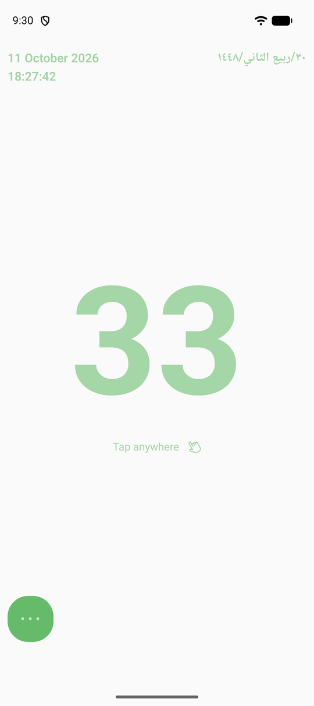&nbsp;
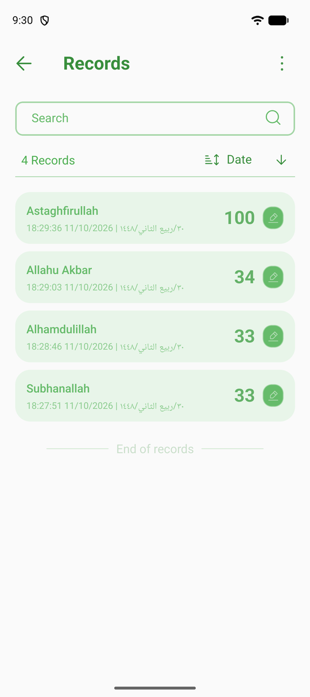&nbsp;
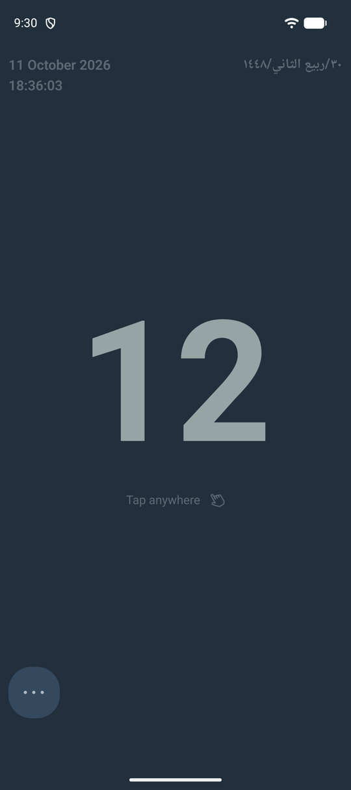

</div>

---

## Features

- **Tap anywhere to count.** The whole screen is the button, so you can count without looking.
- **Or swipe instead.** Choose Swipe Up, Down, Left or Right if you prefer a gesture.
- **Save your dhikr.** Name a session (Subhanallah, Alhamdulillah…) and save the count with a timestamp.
- **Records history.** Search, sort by date, edit, and multi-select to delete saved sessions.
- **Gregorian and Hijri dates** shown together on the home screen and on every record.
- **Three themes:** Lime, Midnight and Forest.
- **Works offline.** All records are stored on your device.
- **Built for modern Android:** targets Android 16 (API 36), draws edge-to-edge, and supports 16 KB memory page size devices.

## See it in action

<table>
  <tr>
    <th>Tap, count &amp; save</th>
    <th>Switch themes</th>
    <th>Swipe to count</th>
  </tr>
  <tr>
    <td>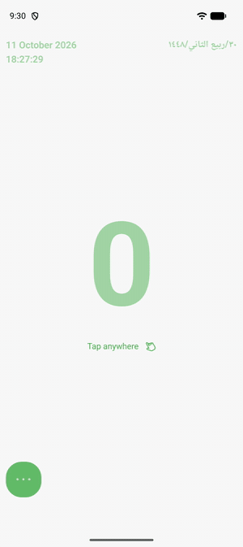</td>
    <td>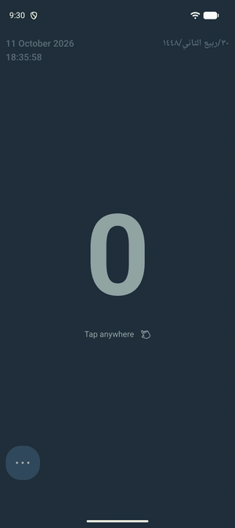</td>
    <td>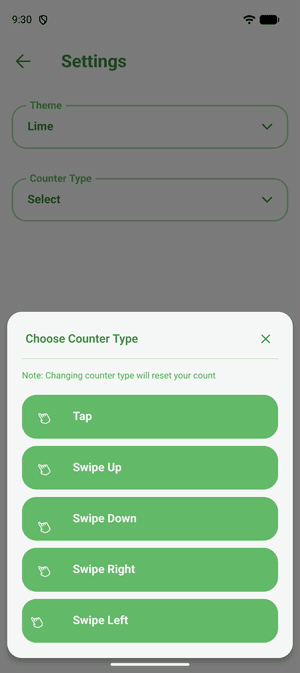</td>
  </tr>
  <tr>
    <td align="center"><a href="docs/media/clicker.mp4">▶ MP4</a></td>
    <td align="center"><a href="docs/media/themes.mp4">▶ MP4</a></td>
    <td align="center"><a href="docs/media/swipe.mp4">▶ MP4</a></td>
  </tr>
</table>

## Screenshots

### Counting

| Tap counter | Quick actions | Swipe counter |
| :---: | :---: | :---: |
|  | 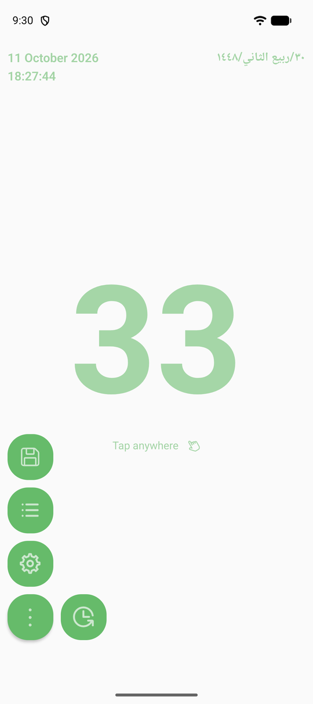 | 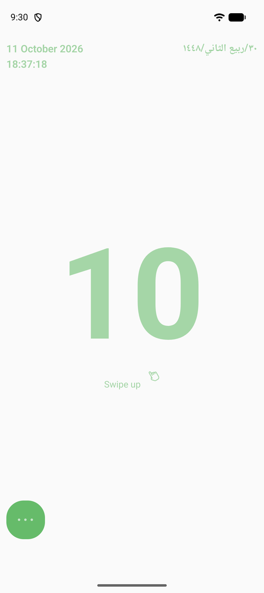 |

### Saving &amp; records

| Save a dhikr | Records | Edit a record | Select &amp; delete |
| :---: | :---: | :---: | :---: |
| 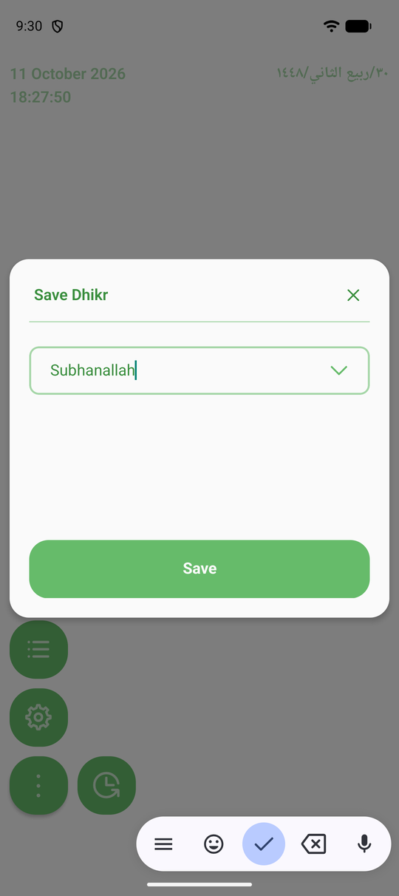 |  | 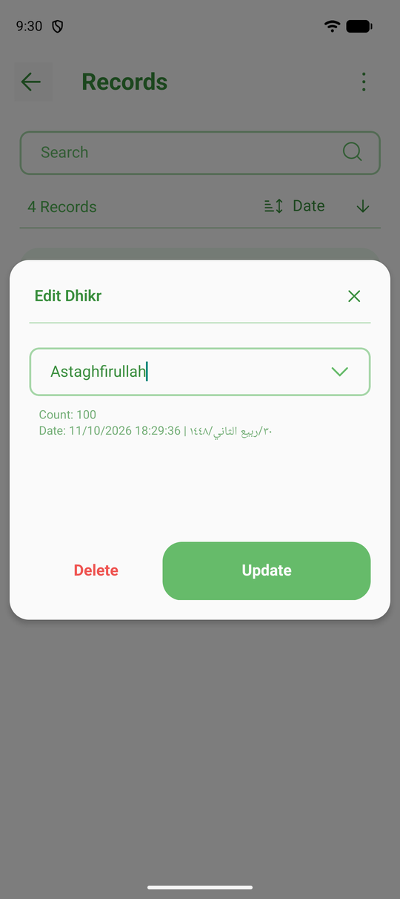 | 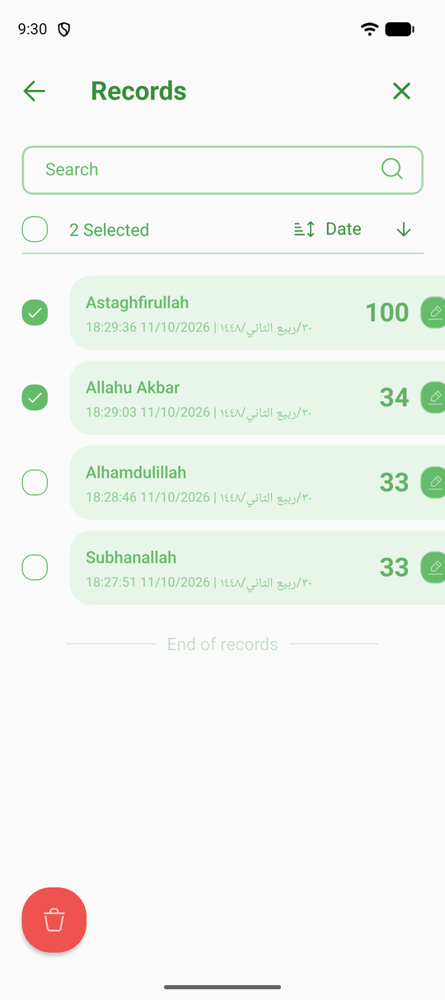 |

### Themes &amp; settings

| Midnight | Forest | Theme picker | Counter type |
| :---: | :---: | :---: | :---: |
| 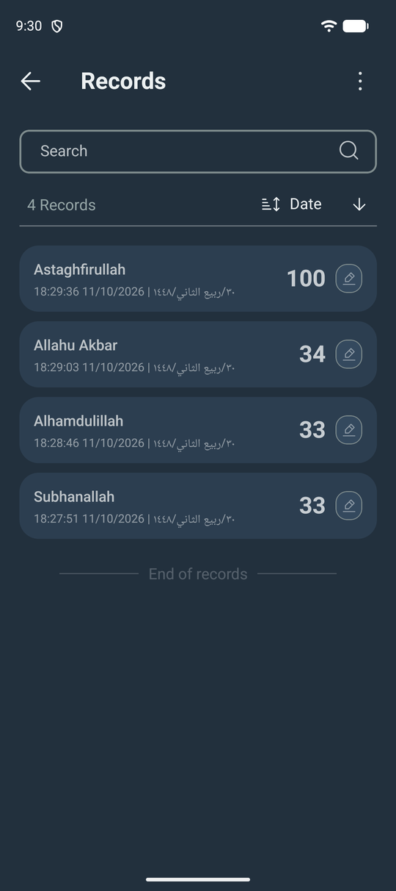 | 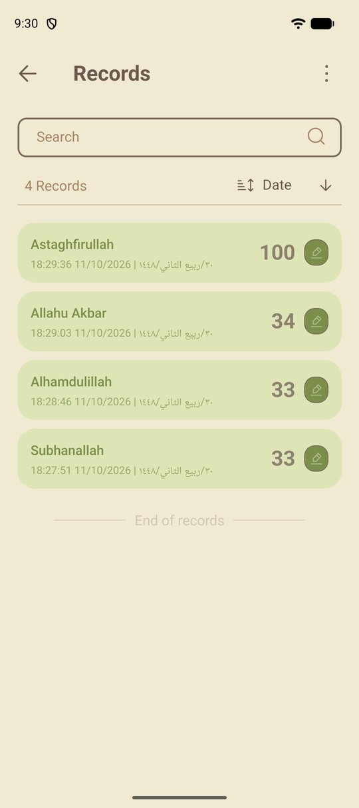 | 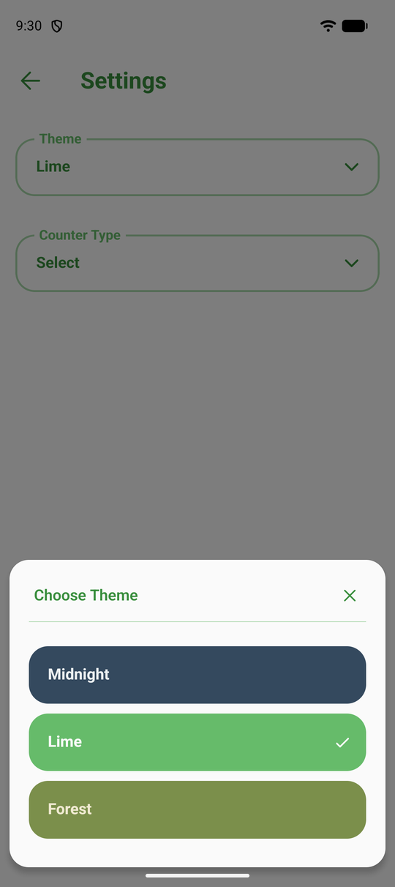 | 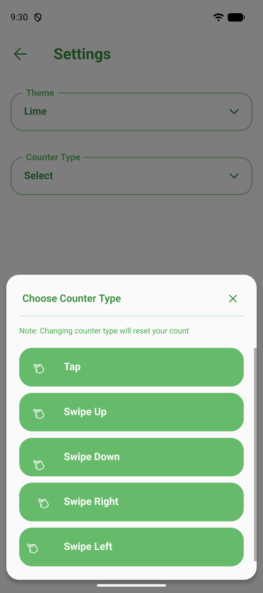 |

## Download

Get the latest APK from the **[Releases page](https://github.com/safadhildev/rnTasbihApp/releases/latest)**, open it on your phone and allow *Install unknown apps* if prompted.

- One universal APK for both 32-bit and 64-bit ARM phones
- Requires **Android 7.0 (API 24)** or newer

---

## Development

### Tech stack

| | |
| --- | --- |
| Framework | React Native 0.86 (New Architecture, Hermes), React 19 |
| Navigation | React Navigation 6 (native stack) |
| Storage | `@react-native-async-storage/async-storage` |
| Dates | `moment` + `moment-hijri` |
| UI | `react-native-svg`, `iconoir-react-native`, `react-native-modal`, `react-native-safe-area-context` |
| Ads | `react-native-google-mobile-ads` (test ads in debug builds) |

### Prerequisites

- Node **22.11+** and Yarn 1.x
- JDK **17**
- Android SDK **36** with NDK **27.1.12297006**
- Set up your machine with the [React Native environment guide](https://reactnative.dev/docs/set-up-your-environment)

### Setup

```bash
yarn install

# Environment files (git-ignored), picked by ENV_FILE (defaults to development)
cp env.example .env.development
cp env.example .env.production
```

### Run

```bash
yarn start                     # Metro
yarn android:dev:debug         # dev flavor (com.myTasbih.dev), test ads
yarn android:production:debug  # production flavor (com.myTasbih)
```

### Test & lint

```bash
yarn test
yarn lint
```

### Release build

Release signing reads `UPLOAD_STORE_FILE`, `UPLOAD_STORE_PASSWORD`, `UPLOAD_KEY_ALIAS` and `UPLOAD_KEY_PASSWORD` from `~/.gradle/gradle.properties`. Keystores and env files are never committed.

```bash
cd android
ENV_FILE=production ./gradlew assembleProductionRelease   # APK → app/build/outputs/apk/production/release/
ENV_FILE=production ./gradlew bundleProductionRelease     # AAB for Google Play
```

The app version lives in [`version.json`](version.json) (`version` is the display name, `build` is the Android `versionCode`). Bump it before each release.

### Project structure

```
src/
├── assets/       # App logo
├── components/   # Counter (Clicker, Swiper), modals, buttons, BackgroundView, context
├── routes/       # Native stack navigator
├── screens/      # Home, Records, Settings, SplashScreen
└── utils/        # Themes, Hijri/Gregorian dates, storage, AdMob helpers
```
